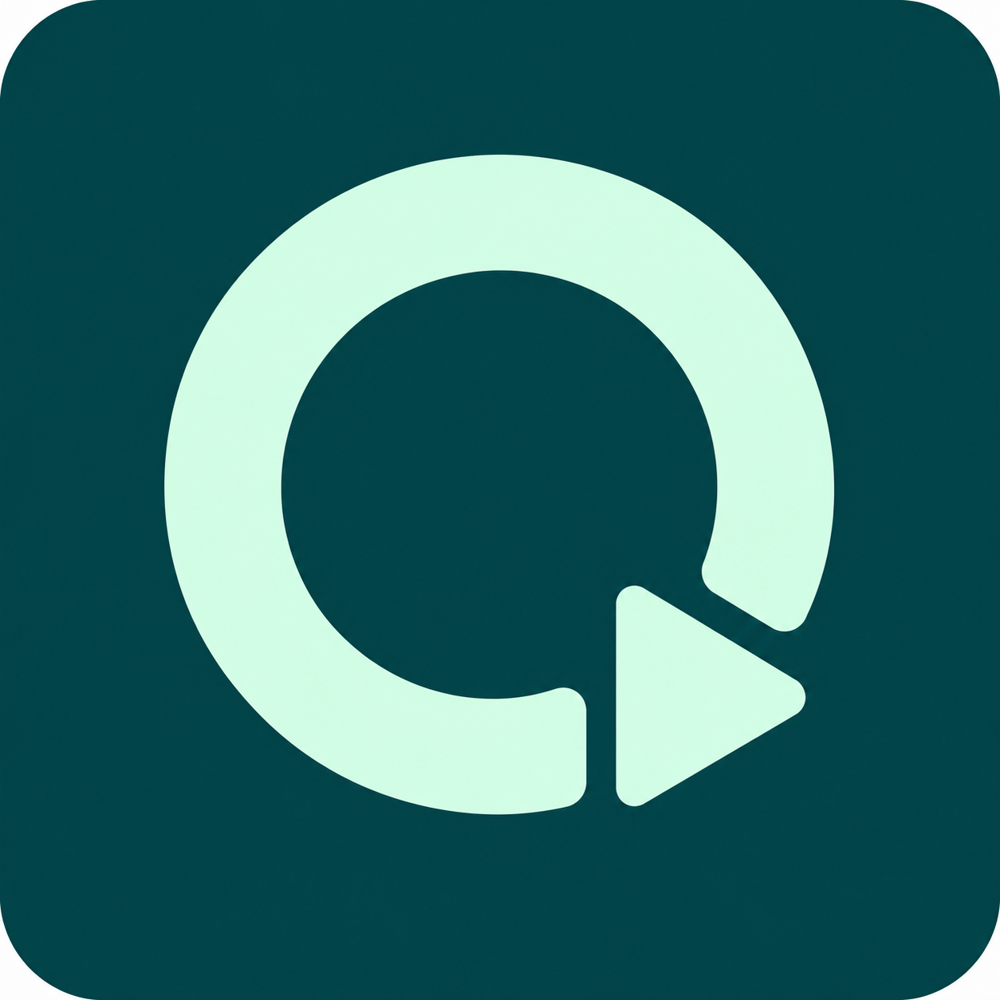

# QuietSkip

A small Chrome extension that mutes YouTube ads, restores your previous mute setting afterward, and clicks Skip as soon as its button is available.

Free and open source under the MIT license. No account, backend, analytics, or tracking. Chrome Web Store publication is pending.

## Install now

1. Download `quietskip-0.3.1.zip` from [Releases](https://github.com/josephtwilliams/quietskip/releases/latest).
2. Extract the ZIP into a folder you will keep on your computer.
3. Open `chrome://extensions` in desktop Chrome and enable **Developer mode**.
4. Choose **Load unpacked**, then select the extracted folder containing `manifest.json`.
5. Review the debugger permission and reload any open YouTube tabs.

If you download the repository instead, select its `extension/` folder. Run only one installed copy. Unpacked installs need manual updates.

## Behavior and permissions

Mutes detected video ads without changing your volume level, preserves an already-muted setting, and sends a browser-level click on a visible enabled Skip control. The popup reports ad status and click attempts.

It does not remove ads, skip ads before YouTube enables Skip, or bypass sign-in or paid content. YouTube player changes can affect detection; report broken behavior in [Issues](https://github.com/josephtwilliams/quietskip/issues).

YouTube rejects ordinary scripted clicks on its Skip control. QuietSkip briefly attaches Chrome's debugger, rechecks the YouTube origin and active ad, finds the current Skip control, sends a mouse press and release, and detaches.

Chrome grants this permission broadly and may display a debugging banner. This implementation restricts it to requests from top-level `https://www.youtube.com/` content scripts and verifies the origin again before acting. It accepts no arbitrary code or coordinates from messages. Open DevTools or another debugger can prevent automatic skipping.

See [Privacy](PRIVACY.md) for data handling details.

## Development

Plain JavaScript, no build step or npm dependencies. Load `extension/` unpacked. After edits, reload the extension and YouTube tabs.

Run `npm test` with a current Node.js version. Run `npm run package` with Python 3 to create the distributable ZIP in `dist/`.

`shared.js` owns ad and button rules. `content.js` manages muting and detection. `background.js` sends trusted browser clicks. `popup.js` reports status.

Tests cover audio restoration, player replacement, button visibility, throttling, origin checks, browser input ordering, and debugger cleanup. Live checks observed ad muting, a Skip attempt without an error, and resumed playback with audio restored. Popup click counts are attempts rather than confirmed successful skips.

## License and artwork

MIT. The logo was generated with OpenAI's built-in image generation tool. QuietSkip is an independent project, not affiliated with YouTube or Google.
